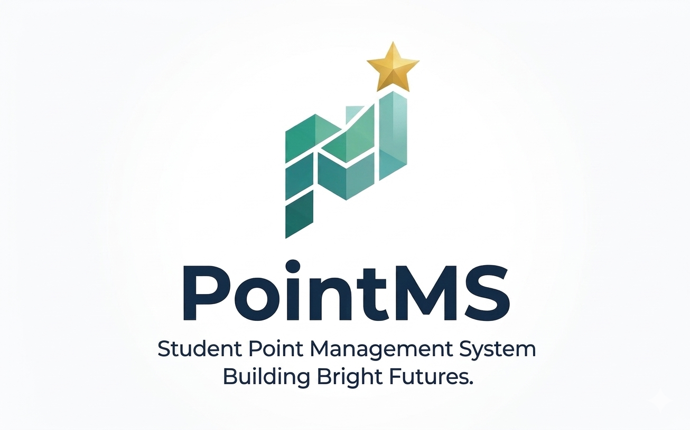

<div align="center">



# Student Point Management System

**PointMS** — track student performance through classes, tasks, submissions, and a flexible point system.

<br/>


<br/><br/>

> 🎓 **Final semester assignment** — This project was built as a **final semester assignment given by the teacher**. It demonstrates a full-stack school workflow using Laravel, Blade, and **MySQL**.

<br/>

<sub>🐾 Soft sky-blue UI · rounded cards · friendly fonts — professional enough for reviewers, warm enough to feel approachable</sub>

</div>

---

## Table of Contents

- [About](#about)
- [Features](#features)
- [User Roles](#user-roles)
- [Tech Stack](#tech-stack)
- [Requirements](#requirements)
- [Installation (MySQL)](#installation-mysql)
- [Database Seeding](#database-seeding)
- [Task & Submission Workflow](#task--submission-workflow)
- [Point System](#point-system)
- [Project Structure](#project-structure)
- [Development](#development)
- [Docker (optional)](#docker-optional)

---

## About

**PointMS** (Student Point Management System) is a web application for schools to monitor student progress in a structured, transparent way.

Teachers create **school classes** with unique join codes, publish **tasks** with deadlines, review **submissions**, and record **points** (positive or negative). Students enroll in classes, accept tasks, submit work, and view their own history and reports. Admins oversee users, subjects, assignments, classes, tasks, and system-wide statistics.

The interface uses a **light sky-blue palette** (`#f0f9ff`, `#bae6fd`, `#0284c7`), soft dot-pattern backgrounds, rounded cards, and fonts **Nunito** + **Sora** — a calm, classroom-friendly look that still reads as polished for teachers, graders, or portfolio reviewers. 🐾

### Active roles

The application is designed around three roles: **Admin**, **Teacher**, and **Student**. Registration and dashboards focus on these roles only.

Demo Website Hosted at https://point-management.online, this project is a final semester assignment given by the teacher 

---

## Features

| Module | What you can do |
|--------|-----------------|
| **Landing page** | Public home with feature overview; links to login and register |
| **Authentication** | Session-based login; self-registration with role selection (admin / teacher / student) |
| **Role middleware** | Routes protected by `role:admin`, `role:teacher`, or `role:student` |
| **User management (admin)** | Create, update, delete users; filter by role |
| **Subjects (admin)** | CRUD school subjects |
| **Teacher–subject links (admin)** | Assign teachers to subjects and school classes |
| **School classes** | Teachers create classes with codes; students join via code; admins manage all classes |
| **Class enrollments** | Students join or leave classes; teachers/admins view rosters and remove students |
| **Tasks** | Teachers create tasks (title, description, due date, max grade) tied to teacher–subject |
| **Task detail** | Shared task detail view for all authenticated roles |
| **Submissions** | Students accept (`taken`) and submit work; teachers move through correcting → graded |
| **Grading** | Teachers set grades, feedback, and submission status |
| **Attachments** | Support for task images, attachments, and submission files (migrations in place) |
| **Points** | Positive/negative points per student and subject; optional link to graded submissions |
| **Reports** | Admin, teacher, and student report pages with statistics |
| **Class export** | Teachers and admins export student lists from a class |
| **Legacy homeroom data** | Majors and homeroom `classes` table (used for student profile / demo seed) |

---

## User Roles

### Admin

- Dashboard with counts: users, tasks, submissions, points
- Manage **users**, **subjects**, **teacher–subject** assignments
- Manage **tasks** and view all **submissions**
- Create and manage **school classes**; add/remove enrolled students
- Award or deduct **points** for any student
- View **reports** and class-level exports

### Teacher

- Create and manage **school classes** (name, subject, description, unique **join code**)
- Publish **tasks** with due dates and max grades
- Review **submissions**: mark as correcting, grade, add feedback
- Award or deduct **points** for students in their subjects
- View **reports**, class rosters, and **export** student lists
- View/regenerate class **join codes** for students

### Student

- **Join classes** using a teacher-provided code
- Browse **tasks**, **accept** them, and **submit** work
- Track submission status: `taken` → `submitted` → `correcting` → `graded`
- View **point history** and personal **statistics**
- View **reports** and leave classes when needed

---

## Tech Stack

| Layer | Technology |
|-------|------------|
| Backend | Laravel 12, PHP 8.2+ |
| Frontend | Blade templates, Tailwind CSS 4, Vite |
| Database | **MySQL** or **postgresql** |
| Auth | Laravel session authentication + custom `RoleMiddleware` |
| Fonts | Google Fonts — Nunito, Sora, Syne (dashboards) |
| Dev tools | Laravel Pail, PHPUnit, optional Docker |

---

## Requirements

- **PHP 8.2+** with extensions: `pdo`, `pdo_mysql`, `mbstring`, `openssl`, `tokenizer`, `xml`, `ctype`, `json`, `fileinfo`
- **Composer**
- **Node.js 18+** and npm
- **MySQL 8+** (or MariaDB 10.3+) — create an empty database before migrating
- Web server or `php artisan serve` for local development

---

## Installation (MySQL)

### 1. Clone the repository

```bash
git clone <your-repo-url>
cd point-management
```

### 2. Install PHP and Node dependencies

```bash
composer install
npm install
```

### 3. Environment setup

```bash
cp .env.example .env
php artisan key:generate
```

Edit `.env` and configure **MySQL** (example):

```env
DB_CONNECTION=mysql
DB_HOST=127.0.0.1
DB_PORT=3306
DB_DATABASE=point_management
DB_USERNAME=root
DB_PASSWORD=your_mysql_password
```

Create the database in MySQL before running migrations:

```sql
CREATE DATABASE point_management CHARACTER SET utf8mb4 COLLATE utf8mb4_unicode_ci;
```

Also set your app URL if needed:

```env
APP_URL=http://127.0.0.1:8000
```

### 4. Run migrations

```bash
php artisan migrate
```

This creates all tables: users, teachers, students, subjects, school classes, enrollments, tasks, submissions, points, and related pivot/attachment tables.

### 5. Seed the database

Choose **one** option below — see [Database Seeding](#database-seeding) for full details.

```bash
# Minimal — admin account only (DefaultSeeder via DatabaseSeeder)
php artisan db:seed

# Full demo dataset for testing and presentations
php artisan db:seed --class=DemoDatabaseSeeder
```

### 6. Build frontend assets

```bash
npm run build
```

For development with hot reload:

```bash
npm run dev
```

### 7. Start the application

```bash
php artisan serve
```

Open **http://127.0.0.1:8000** in your browser.

### Quick setup (Composer)

Laravel’s `composer setup` script installs dependencies, copies `.env`, generates the key, and runs migrations — **you still need to configure MySQL in `.env` and run a seed manually**:

```bash
composer setup
php artisan db:seed
# or
php artisan db:seed --class=DemoDatabaseSeeder
```

---

## Database Seeding

The project includes two seeders. Use the one that matches your goal.

| Seeder | Command | Best for |
|--------|---------|----------|
| **DefaultSeeder** | `php artisan db:seed` | Production-like setup, blank slate, only admin |
| **DemoDatabaseSeeder** | `php artisan db:seed --class=DemoDatabaseSeeder` | Demos, grading, exploring every feature |

Both are invoked through Laravel’s seeder system. `DatabaseSeeder` only calls `DefaultSeeder`.

---

### Option A — Default seed (`DefaultSeeder`)

**When to use:** You want a **clean database** with a single administrator and will create teachers, students, subjects, and classes yourself through the UI.

**Command:**

```bash
php artisan db:seed
```

Equivalent explicit call:

```bash
php artisan db:seed --class=DefaultSeeder
```

**What gets created:**

| Field | Value |
|-------|-------|
| Name | Admin User |
| Username | `admin` |
| Email | `admin@school.edu` |
| Password | `password` |
| Role | `admin` |

**Next steps after seeding:**

1. Log in as admin.
2. Create subjects and users (teachers / students) from the admin dashboard.
3. Assign teacher–subject links and school classes.
4. Have students register or be created, then join classes with join codes.

---

### Option B — Demo seed (`DemoDatabaseSeeder`)

**When to use:** You need **ready-made sample data** to explore tasks, submissions, points, and class enrollments without manual setup — ideal for local testing, teacher review, or presentation.

**Command:**

```bash
php artisan db:seed --class=DemoDatabaseSeeder
```

> ⚠️ Run on a **fresh database**. Seeding demo data on top of existing rows may cause duplicate key errors. Prefer:

```bash
php artisan migrate:fresh --seed --seeder=DemoDatabaseSeeder
```

That drops all tables, re-runs migrations, and seeds in one step.

**What gets created:**

| Category | Details |
|----------|---------|
| **Majors** | Computer Science, Mathematics |
| **Homeroom classes** | X-CS-1, X-CS-2, X-MTK-1 (legacy student `class_id`) |
| **Subjects** | Mathematics, English, Programming, Physics |
| **Users** | 1 admin, 3 teachers, 5 students |
| **School classes** | 4 teacher-owned classes with join codes (`MATH-CS1`, `PROG-CS2`, `ENG-CS1`, `PHY-MTK1`) |
| **Enrollments** | Students enrolled across multiple school classes |
| **Teacher–subjects** | Links between teachers, subjects, and school classes |
| **Tasks** | 3 sample assignments with due dates |
| **Submissions** | Mix of `graded`, `submitted`, `correcting`, and `taken` |
| **Points** | Positive and negative records, including one tied to a graded submission |

**Demo login credentials** — password for **every account** is `password`:

| Role | Name | Email | Username |
|------|------|-------|----------|
| Admin | Admin User | `admin@school.edu` | `admin` |
| Teacher | John Doe | `john@school.edu` | `johndoe` |
| Teacher | Jane Smith | `jane@school.edu` | `janesmith` |
| Teacher | Mr. Hasan | `hasan@school.edu` | `mrhasan` |
| Student | Ahmad Riski | `ahmad@school.edu` | `ahmad` |
| Student | Siti Rahma | `siti@school.edu` | `siti` |
| Student | Budi Santoso | `budi@school.edu` | `budi` |
| Student | Dewi Putri | `dewi@school.edu` | `dewi` |
| Student | Rizki Fajar | `rizki@school.edu` | `rizki` |

**Try the demo flow:**

1. Log in as **johndoe** (teacher) → view classes `MATH-CS1` / `PROG-CS2`, tasks, and submissions.
2. Log in as **ahmad** (student) → see enrolled classes, graded algebra homework, and points.
3. Log in as **admin** → system-wide users, reports, and class management.

---

## Task & Submission Workflow

```
Teacher creates task (linked to teacher–subject / school class)
              ↓
Student accepts task          →  status: taken
              ↓
Student submits work          →  status: submitted
              ↓
Teacher marks correcting      →  status: correcting
              ↓
Teacher grades submission     →  status: graded
              ↓
Points may be recorded (manual or linked to submission)
```

Submission statuses used in the app: `taken`, `submitted`, `correcting`, `graded`.

---

## Point System

- Points are stored per **student** and **teacher–subject** (and school class context).
- **Type:** `positive` or `negative`
- **Description** and **point_date** for audit trail
- Optional **`task_submission_id`** when points come from grading
- Teachers manage points for their subjects; admins can manage points globally

---

## Project Structure

```
app/
├── Http/
│   ├── Controllers/
│   │   ├── AuthController.php      # Login, register, dashboards
│   │   ├── TaskController.php      # Tasks, submissions, points, admin CRUD
│   │   ├── ClassController.php     # School classes, join codes, export
│   │   ├── UserController.php
│   │   └── ReportController.php
│   └── Middleware/
│       └── RoleMiddleware.php      # role:admin | teacher | student
├── Models/
│   ├── User.php, Teacher.php, Student.php
│   ├── SchoolClass.php, ClassEnrollment.php
│   ├── Task.php, TaskSubmission.php
│   ├── Point.php, Subject.php, TeacherSubject.php
│   └── Major.php, Classes.php (legacy homeroom)
database/
├── migrations/                   # MySQL schema
└── seeders/
    ├── DatabaseSeeder.php        # → DefaultSeeder
    ├── DefaultSeeder.php         # Admin only
    └── DemoDatabaseSeeder.php    # Full demo dataset
resources/views/
├── index.blade.php               # Public landing (sky-blue theme)
├── auth/                         # login.blade.php, register.blade.php
└── dashboard/
    ├── admin.blade.php
    ├── teacher.blade.php
    └── student.blade.php
routes/
└── web.php                       # All HTTP routes
public/
└── storage_backup/Icon.png       # App icon
```

---

## Development

Run server, queue, logs, and Vite together:

```bash
composer dev
```

Run tests:

```bash
composer test
# or
php artisan test
```

Useful Artisan commands:

```bash
php artisan migrate:fresh --seed --seeder=DemoDatabaseSeeder   # Reset DB + demo data
php artisan route:list                                         # List all routes
php artisan storage:link                                       # If using public disk uploads
```

---

## Docker (optional)

A `Dockerfile` is included for containerized deployment. Configure `.env` with your MySQL host (or a linked MySQL container), then run migrations and your chosen seeder inside the container:

```bash
docker build -t point-management .
docker run -p 8000:8000 point-management
```

---

<div align="center">

### Built with care for the classroom 🐾

*Final semester assignment — Student Point Management System*

<br/>

<sub>Laravel 12 · MySQL · Keep learning ✨</sub>

</div>
